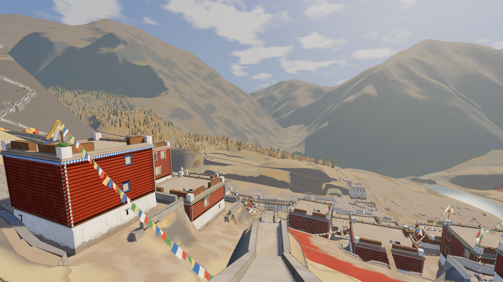
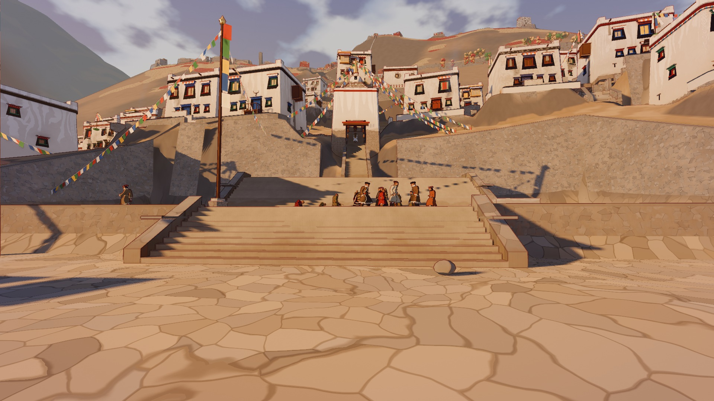
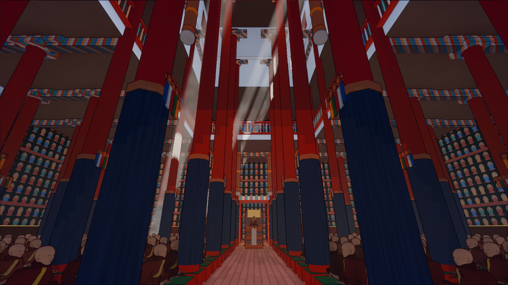
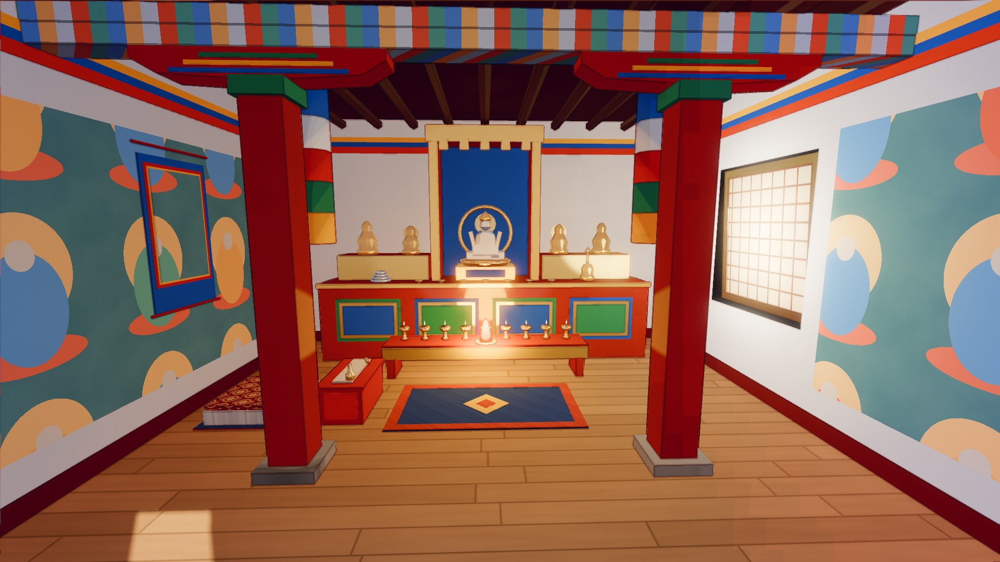
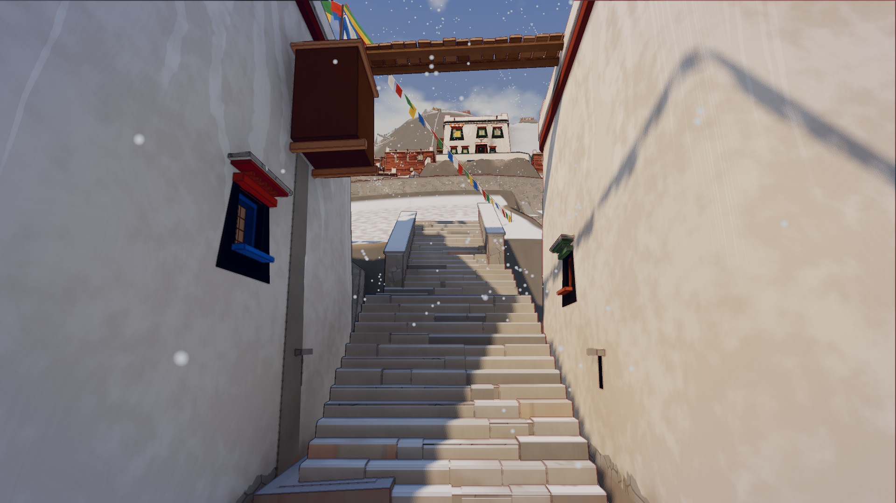
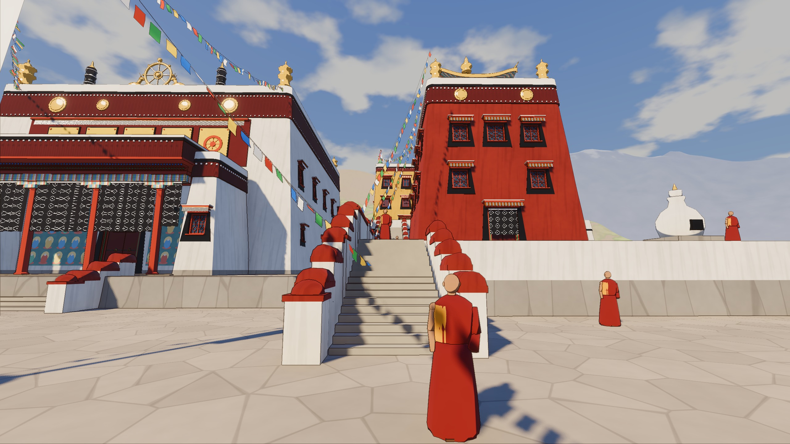

# Dungkardo (tibet-godot)

A stylized, walkable Tibetan border town in the autumn of 1903, built in Godot 4.7. It began as a single alley and a red chapel and has grown into a terraced town on a real mountainside: flat roofs joined by notched-log ladders, a market square, a Gelug monastery up 1,080 steps, painted interiors, and townspeople and monks who keep their own hours. The look is painterly: soft two-tone light with cool shadows, ink outlines, a painted sky, prayer flags and grass moving in the wind, incense and juniper smoke, mist and snow.

| | |
|---|---|
|  |  |
|  |  |

The first five pictures are from the full town build; the last is the original vignette, which is what a fresh clone runs (see below).

## Features

- Shaders written for the look: `shaders/stylized.gdshader` (painterly colour, toon highlights, rim light, world-space patterns for flagstones, murals, painted beams, terrain and gilded tiles), `shaders/outline.gdshader` (screen-space ink lines, O toggles them), a painted sky with drifting clouds, prayer flags, grass and foliage in the wind, mist layers and falling snow.
- A day that runs: sun and moon from a 1903 Tibetan and Chinese calendar, lighting keyframes from dawn to night, lamps lit at dusk, the monastery's dawn horns, the town's roof burners smoking at their hours.
- A third-person player (first person on V) with World of Warcraft style mouse and keyboard controls or a PS4 controller: jog, sprint, walk, jump, climb ladders, sit, talk, a fist fight and a sling.
- People with schedules: townspeople, named characters, novices and monks at the assemblies, caravans and herds, crowds drawn with vertex-animation textures.
- Interiors streamed in at the doors, curtains that part, boots left at the hall doors.
- A codex and a ledger, Tibetan and Chinese text shaped in the game's own fonts.
- Automated checks: GUT unit tests, scripted walks over every route, still sets compared against references.

## Run it

1. Install [Godot 4.7](https://godotengine.org/download) (the standard build; the project uses Forward+ and Jolt physics).
2. Clone this repository. No Git LFS is needed.
3. Open `project.godot` in Godot and press Play, or run `godot --path path/to/tibet-godot`.

A fresh clone plays the original vignette: the alley, the red chapel, the courtyard, walking monks and prayer flags. Controls: W, A, S, D move; the mouse looks; Shift sprints; Space jumps; F flies (E and Q up and down); O toggles the ink lines; the number keys jump between viewpoints; Esc frees the mouse.

Save a still from a viewpoint and quit: `godot --path . -- --view=1 --shot=/tmp/view1.png`.

## Building the full town

The town, its terrain and its people are generated, not committed. The building and character geometry comes from the companion Blender kit, [tibet-blender](https://github.com/gregoryjayuk/tibet-blender), cloned next to this repository; the terrain is built from public elevation data by the Python tools in `tools/terrain/`. The pipeline needs Blender, Python 3 with Pillow, numpy, scipy and rasterio (`tools/py`), and the downloads listed in `tools/vendor/fetch_m0.sh`. In outline:

1. `tools/vendor/fetch_m0.sh` fetches the elevation tiles and other third-party inputs into `~/.cache/dungkardo/`.
2. `Blender -b --factory-startup --python ../tibet-blender/export_types.py` exports the building kit into `assets/generated/`, then `godot --headless --path . --import`.
3. `tools/terrain/build.sh` builds the terrain, the town layout, the street graph and the walkways.
4. `tools/play.sh valley` walks the whole town (`AT=gonpa`, `AT=steps`, `HOUR=16` and other options are listed in the script); `tools/play.sh street` walks the kit-built street.

The pipeline has so far only been run on macOS on Apple silicon; treat it as a working reference rather than a one-command build.

## Tests

`godot --headless --path . -s addons/gut/gut_cmdln.gd -gdir=res://tests/unit -gexit` runs the unit tests. Tests that look at the town, its people or its interiors need the generated world above and skip or fail without it.

## Layout

- `main.gd`, `world/vignette.gd`: the vignette. `tests/terrain/s3.gd`: the full town's scene, its viewpoints, routes and still stations.
- `world/`: the town, the day, weather, people's days, interiors, sound places. `autoload/`: clock, calendar, quality tiers, controls, streaming, story, saves.
- `shaders/`, `characters/`, `player/`, `ui/`, `interiors/`: what the names say.
- `data/`: the town plan, the population, the calendar, the palette, dialogue and codex text, all as JSON.
- `tools/`: the build pipeline (Python and shell), shot and performance tools. `tests/`: unit tests and scripted runs.
- `docs/DESIGN.md`: the setting and the design in brief. `docs/VENDOR.md`: every third-party file, its version, source and licence.

Code comments refer to chapters of a longer design plan and to issue numbers (ISS-, IMP-) in working notes that are not part of this repository.

## Credits and licences

The project's own code, data, shaders and pictures are under the MIT licence (`LICENSE`), copyright 2026 Greg Gaynor. Third-party parts keep their own licences, which sit beside them:

- [Terrain3D](https://github.com/TokisanGames/Terrain3D) 1.0.2 (`addons/terrain_3d/`): MIT, Cory Petkovsek, Roope Palmroos and contributors.
- [GUT](https://github.com/bitwes/Gut) 9.7.1 (`addons/gut/`): MIT, Tom "Butch" Wesley; its bundled fonts (Anonymous Pro, Courier Prime, Lobster Two) are under the SIL Open Font Licence (`addons/gut/fonts/OFL.txt`).
- Fonts in `assets/source/fonts/`: Jomolhari (SIL OFL 1.0), Noto Serif Tibetan, Noto Serif TC and Noto Serif (SIL OFL 1.1), and AR PL UKai (Arphic Public License, shipped whole and unmodified with `ARPHICPL.TXT`). Sources and checksums are in `docs/VENDOR.md`.
- Sound effects from [Kenney](https://kenney.nl)'s RPG Audio and Impact Sounds packs (CC0) are fetched by `tools/audio/fetch_kenney.sh` and are not committed; `audio/CREDITS.csv` lists them.
- Terrain: produced using Copernicus WorldDEM-30 © DLR e.V. 2010-2014 and © Airbus Defence and Space GmbH 2014-2018 provided under COPERNICUS by the European Union and ESA; all rights reserved. The data is provided without any warranty or liability, and nothing here implies endorsement.
- The night sky's stars come from the Yale Bright Star Catalogue, 5th revised edition (CDS, catalogue V/50). The 1903 Chinese calendar dates follow the Hong Kong Observatory's conversion tables.
